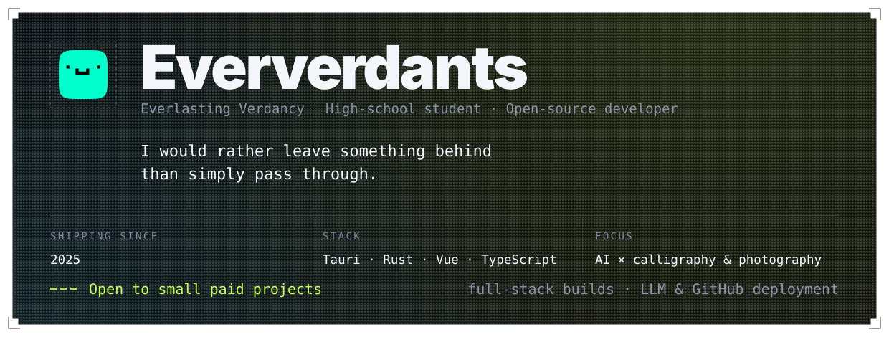
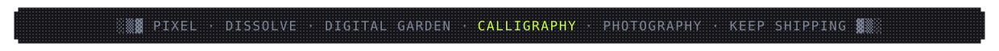

## 01 · Stack

       

 

      

## 02 · Signals

 

  

## 03 · Selected works

## 04 · Elsewhere

   

## 05 · Contributions

<picture>
  <source media="(prefers-color-scheme: dark)" srcset="https://raw.githubusercontent.com/Eververdants/Eververdants/output/github-contribution-grid-snake-dark.svg">
  <source media="(prefers-color-scheme: light)" srcset="https://raw.githubusercontent.com/Eververdants/Eververdants/output/github-contribution-grid-snake.svg">
  
</picture>

 

